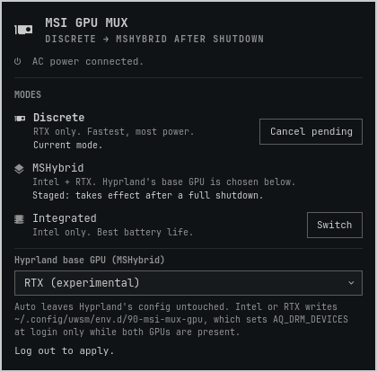

# MSI GPU MUX

A bar widget for [Omarchy](https://omarchy.org) that switches the hardware GPU
MUX of supported MSI laptops between **Discrete**, **MSHybrid** and
**Integrated**, from the top bar instead of a terminal.



The icon shows the current mode, with a small badge while a switch is staged and
waiting for a full shutdown. Click it for the panel:

- the current mode, and the staged one ("Discrete → MSHybrid after shutdown");
- whether AC power is connected (the firmware switch requires it);
- the three modes, each with a one-line description and a **Switch** button
  (when a button is disabled, the row says why); while a switch is staged, the
  current mode offers **Cancel pending**;
- in MSHybrid, a **Hyprland base GPU** dropdown (see
  [What this does to your Hyprland config](#what-this-does-to-your-hyprland-config)).

| Mode | What it is |
|---|---|
| **Discrete** | RTX GPU only. Fastest, highest battery use. External screens are driven directly. |
| **MSHybrid** | Intel + RTX. Hyprland composites on one GPU and copies frames to the screens on the other. |
| **Integrated** | Intel only. Best battery; external screens wired to the RTX probably stay dark. |

Every switch asks for confirmation first, then for your password through
Omarchy's own polkit prompt. A switch only **stages** the new mode: it takes
effect after a **full shutdown** and power-on. A reboot is not enough. After a
successful switch the panel offers **Shut down now** (Omarchy's
`omarchy-system shutdown`) or **Later**.

The panel works from the keyboard too: the first key press shows a cursor,
the arrow keys (or `j`/`k`) move it between the enabled buttons and the
dropdown, Enter or Space activates, Esc closes.

The widget is hidden on machines that are not MSI. On an MSI machine it is
shown but greyed, with the reason and how to fix it, when the backend is
missing, not set up safely, or the model is not one the plugin knows.

## What you need

- An Omarchy desktop.
- A supported MSI laptop (see [Supported machines](#supported-machines-and-the-override-flags)).
- **msi-mux-switch**, the command-line tool that does the actual firmware
  switch: [github.com/steelbrain/msi-gpu-mux-switch](https://github.com/steelbrain/msi-gpu-mux-switch).
  It is MIT licensed, by its own author. This plugin only calls it; it never
  bundles, builds, downloads or updates it.

## Install

Add the plugin to Omarchy. It is installed as a local plugin folder named by
its id, `~/.config/omarchy/plugins/io.github.rsd.msi-mux`:

```bash
omarchy plugin add https://github.com/rsd/omarchy-msi-mux-plugin.git --enable
```

Or copy (or clone) this repository to
`~/.config/omarchy/plugins/io.github.rsd.msi-mux` yourself and run
`omarchy plugin enable io.github.rsd.msi-mux`.

Then set up the backend (next section). Until then the icon is greyed and the
panel says why.

## Backend setup

### 1. Build and install msi-mux-switch

Building msi-mux-switch is outside this plugin. Follow its README at
[github.com/steelbrain/msi-gpu-mux-switch](https://github.com/steelbrain/msi-gpu-mux-switch)
(it is a Rust program; the plugin was written against commit `223ca06`), and
put the binary in a folder of its own. The plugin looks for it at
`/opt/msi-mux-switch/msi-mux-switch` by default; the **msi-mux-switch path**
setting of the widget changes that.

### 2. Make it root-owned

The plugin runs the switch as root, through `pkexec`. Running a file as root
is only safe if nobody but root can change it, so the plugin refuses to switch
unless:

- the binary is a regular file (not a symbolic link), owned by root, and not
  writable by group or others; and
- **every directory above it**, up to `/`, is owned by root and not writable
  by group or others; and
- it is not under `/media`, `/mnt`, `/run/media` or `/run/user`, where a user
  can mount a disk or owns the files.

The second rule is stricter than checking the file alone on purpose: if you
can write the folder the binary sits in, you can replace the binary with
another file, and the next switch would run that as root. The same goes for
any folder further up.

When the check fails, the panel shows the reason (for example
"/opt/msi-mux-switch/msi-mux-switch is owned by alice, not root.") and a
**Set up backend** button. It opens a terminal running the plugin's
`setup.sh`, which:

1. checks that the binary exists and is a regular file;
2. shows the exact commands it will run, for the binary and its own folder
   only:

   ```bash
   sudo chown -h root:root -- /opt/msi-mux-switch
   sudo chmod 755 -- /opt/msi-mux-switch
   sudo install -o root -g root -m 755 -- /opt/msi-mux-switch/msi-mux-switch /opt/msi-mux-switch/.msi-mux-switch.new
   sudo mv -f -- /opt/msi-mux-switch/.msi-mux-switch.new /opt/msi-mux-switch/msi-mux-switch
   ```

3. asks before running them, then checks again.

The folder is made root-owned first, so nothing in it can be swapped any more;
then the binary is checked again (still a regular file, still alone in the
folder) and replaced by a fresh root-owned copy. The binary is never chowned
in place: a program that still had it open for writing could otherwise change
it after it became root's.

It refuses, and changes nothing, when:

- the binary's folder is your home, `/`, or a folder directly under `/` or
  `/home`, or the binary is under `/media`, `/mnt`, `/run/media` or
  `/run/user`;
- the folder is owned by someone other than you or root, has the sticky bit
  (a shared folder such as `/var/tmp`), is writable by group or others, or
  holds anything besides the binary (dotfiles included);
- a folder further up fails the check.

Move the binary to a folder of its own (such as `/opt/msi-mux-switch`)
instead. You can run it by hand too:

```bash
bash ~/.config/omarchy/plugins/io.github.rsd.msi-mux/setup.sh /opt/msi-mux-switch/msi-mux-switch
```

After that, open the panel again: the buttons are enabled (on AC power).

msi-mux-switch keeps a rollback record of each switch. Because it runs under
`pkexec`, as root, those records land in root's state directory
(`/root/.local/state/msi-gpu-mux/backups`), not yours.

## Supported machines and the override flags

msi-mux-switch has its own table of characterized machines (model, board and
BIOS version, all exact). At commit `223ca06` it lists:

| Model | Board | BIOS |
|---|---|---|
| Vector 16 HX AI A2XWIG | MS-15M3 | E15M3IMS.116 |
| Stealth 16Studio A13VG | MS-15F2 | E15F2IMS.10F |

On any other machine the tool refuses, even for its read-only state read,
unless it is given `--allow-unsupported-hardware` (and, for a switch on a known
model with another BIOS, `--allow-unvalidated-bios`).

The plugin never passes those flags on its own judgment. It keeps a small
**allowlist** of exact model / board / BIOS combinations it has been used on,
and passes both flags, for reads and switches, only there:

| Model | Board | BIOS |
|---|---|---|
| Vector 16 HX AI A2XWIG | MS-15M3 | E15M3IMS.10E |

That entry is reported upstream as
[steelbrain/msi-gpu-mux-switch#2](https://github.com/steelbrain/msi-gpu-mux-switch/issues/2).
A machine in the tool's own table gets no flags. Any other MSI machine shows the
widget greyed, naming its model, board and BIOS. Both tables are fixed in the
plugin; no setting widens them. The plugin reads the values from
`/sys/class/dmi/id/`.

## Settings

In the bar's widget settings:

| Setting | Default | Meaning |
|---|---|---|
| **msi-mux-switch path** (`binaryPath`) | `/opt/msi-mux-switch/msi-mux-switch` | Absolute path to the binary. Must not contain `..`. |
| **Warn about external screens before Integrated** (`warnBeforeIntegrated`) | on | Adds the external-screen warning to the confirmation before staging Integrated. |

## What this does to your Hyprland config

Nothing, unless you pick **Intel** or **RTX** in the panel's **Hyprland base
GPU** dropdown (shown in every mode, current or pending). The default,
**Auto**, means the plugin owns no file and leaves Hyprland alone.

In MSHybrid, both GPUs are present and Hyprland composites on one of them
(usually the Intel GPU), copying frames to the screens wired to the other.
Picking a base GPU writes exactly one file:

```
~/.config/uwsm/env.d/90-msi-mux-gpu
```

(creating `~/.config/uwsm/env.d` if it does not exist). uwsm sources the files
in that folder with `sh` when you log in, before Hyprland starts; this one sets
`AQ_DRM_DEVICES`, which tells Hyprland's backend (aquamarine) which GPU to use
first. No existing file is edited: nothing else in `~/.config/uwsm` or
`~/.config/hypr` is read, changed, renamed or touched.

For the **RTX (experimental)** choice the file is exactly:

```sh
# Written by the MSI GPU MUX Omarchy plugin (io.github.rsd.msi-mux).
# msi-mux-base: rtx
#
# In MSHybrid mode, makes Hyprland composite on the RTX (NVIDIA) GPU: when both
# an Intel and an NVIDIA GPU are present, AQ_DRM_DEVICES lists that GPU
# first. With only one GPU present (Discrete or Integrated mode) it
# exports nothing. uwsm sources this file at login; it prints nothing.
#
# To remove the effect, pick Auto in the plugin, or delete this file and
# log out.

msi_mux_intel=
msi_mux_nvidia=
for msi_mux_card in /sys/class/drm/card*; do
  case ${msi_mux_card##*/} in
    *-*) continue ;;
  esac
  msi_mux_vendor=$(cat "$msi_mux_card/device/vendor" 2>/dev/null) || msi_mux_vendor=
  case $msi_mux_vendor in
    0x8086) [ -n "$msi_mux_intel" ] || msi_mux_intel=/dev/dri/${msi_mux_card##*/} ;;
    0x10de) [ -n "$msi_mux_nvidia" ] || msi_mux_nvidia=/dev/dri/${msi_mux_card##*/} ;;
  esac
done
if [ -n "$msi_mux_intel" ] && [ -n "$msi_mux_nvidia" ]; then
  export AQ_DRM_DEVICES="$msi_mux_nvidia:$msi_mux_intel"
fi
unset msi_mux_intel msi_mux_nvidia msi_mux_card msi_mux_vendor
```

For **Intel** it is the same, with `intel` in the marker line, "the Intel GPU"
in the comment and the two devices the other way round.

What it changes:

- At login, it finds the GPUs under `/sys/class/drm/card*` (skipping the
  connector entries such as `card1-eDP-2`) by their PCI vendor: `0x8086` is
  Intel, `0x10de` is NVIDIA. It does not hard-code card numbers, which change
  across boots and modes.
- Only when **both** are present (MSHybrid) does it export
  `AQ_DRM_DEVICES=<base>:<other>`, for example
  `/dev/dri/card1:/dev/dri/card0`. In Discrete or Integrated one GPU is gone,
  so it exports nothing and Hyprland starts as usual.
- It prints nothing, never exits early and leaves no variable behind.
- It takes effect only in MSHybrid, at the next login: **log out to apply**.
- Switching to Discrete or Integrated does not delete it: your Intel or RTX
  choice is kept for the next time you are in MSHybrid. Outside MSHybrid the
  file is inert, because of the both-GPUs check above.
- The file stays until you pick **Auto** again (the plugin then deletes it) or
  remove it by hand.

RTX as the base GPU is labelled experimental: it is untested.

To remove it by hand:

```bash
rm ~/.config/uwsm/env.d/90-msi-mux-gpu
```

then log out and in. If a graphical login ever fails because of it, switch to a
text console (Ctrl+Alt+F3), log in there and run the same `rm`.

## Removing the plugin

1. Disable it: `omarchy plugin disable io.github.rsd.msi-mux` (and, to
   delete its folder too, `omarchy plugin remove io.github.rsd.msi-mux`).
2. If you ever picked **Intel** or **RTX** as the Hyprland base GPU, remove
   the one file the plugin writes, then log out and in:

   ```bash
   rm ~/.config/uwsm/env.d/90-msi-mux-gpu
   ```

The plugin writes nothing else. msi-mux-switch itself, and the folder you set
up for it, are yours to keep or delete.

## Opening the panel from the Omarchy menu

The plugin adds nothing to the Omarchy menu. If you want an entry, you can add
one yourself to `~/.config/omarchy/extensions/omarchy-menu.jsonc`; this is an
example only, adjust it to taste:

```jsonc
{
  "system.gpu-mux": {"icon":"󰢮","label":"GPU Mode","action":"omarchy-shell io.github.rsd.msi-mux open"}
}
```

## Tests

```bash
bash tests/run.sh
```

runs the manifest validation, the QML lint and load checks, the model tests,
the env file sourced by `sh` against fixture trees, `setup.sh` against a fake
`sudo`, and shellcheck. The tests never run the real msi-mux-switch, `pkexec`,
`sudo` or a shutdown, and never write under `~/.config`.

## Licence

MIT, see [LICENSE](LICENSE). msi-mux-switch is a separate project under its own
MIT licence.
